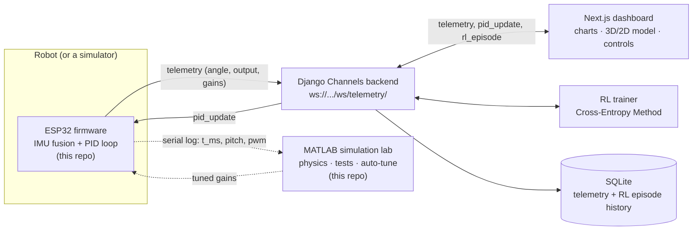
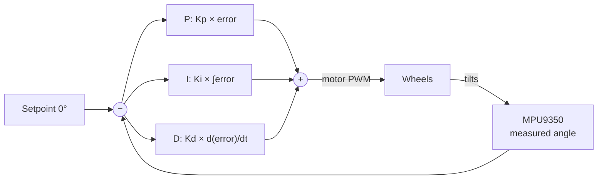
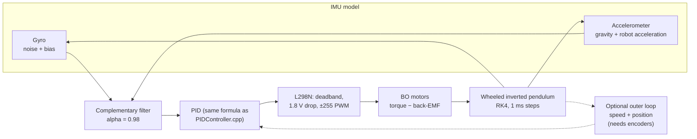

# Self-Balancing Robot

A two-wheel self-balancing robot built on an ESP32 (MPU9350 IMU + L298N/BO
motors), part of a larger project that also includes:

- a Django Channels backend,
- a real-time RL auto-tuner that learns better PID gains from live telemetry,
- a Next.js dashboard with a real-world-scale interactive 2D/3D model of the
  build, live-linked to the robot's actual tilt,
- **a MATLAB physics simulator and analysis dashboard** (in this repo) for
  studying the controller before it ever touches the hardware.

> **This public repo contains the ESP32 firmware, the MATLAB simulation lab,
> and documentation/screenshots for the full project.** The backend and web
> dashboard source live in a private repo — the screenshots below show what
> they do, even though that code itself isn't here.


## Contents

- [What's in this repo](#whats-in-this-repo)
- [How the full project fits together](#how-the-full-project-fits-together)
- [PID control, briefly](#pid-control-briefly)
- [MATLAB simulation lab](#matlab-simulation-lab) — physics model, live dashboard, results
- [Screenshots](#screenshots) — web dashboard, RL training, 3D/2D model, wiring
- [Hardware](#hardware)
- [Running it](#running-it)
- [Design notes worth knowing](#design-notes-worth-knowing)
- [The project story](#the-project-story)

## What's in this repo

| Path | What it is |
|---|---|
| [`firmware/`](firmware/) | ESP32 firmware (PlatformIO): IMU sensor fusion, PID balance loop, WebSocket telemetry client |
| [`matlab/balance_lab.m`](matlab/balance_lab.m) | Single-file MATLAB simulator + live dashboard: physics, PID, sensor model, tests, RL auto-tune |
| [`matlab/results/`](matlab/results/) | CSV logs and summary data from the simulation experiments below |
| [`docs/PID_CONTROL.md`](docs/PID_CONTROL.md) | Plain-language PID write-up with a gain-comparison chart |
| [`docs/matlab/`](docs/matlab/) | Graphs generated by the MATLAB simulator |
| [`docs/screenshots/`](docs/screenshots/) | Screenshots of the web dashboard, MATLAB dashboard, 3D/2D model and RL training |

`firmware/README.md` has full setup/wiring/protocol detail for the firmware.

## How the full project fits together



Every participant — the robot, the dashboard, and the RL trainer — is just a
WebSocket client on the same `/ws/telemetry/` endpoint, all sending and
receiving the same three message types (`telemetry`, `pid_update`,
`rl_episode`). That's *why* the RL trainer can propose new gains: it sends
`pid_update` exactly the way the dashboard's sliders do, so it can never
bypass the firmware's own fall-angle safety cutoff — it's not a separate,
riskier control path, just another client turning the same knob.

The MATLAB lab sits beside this loop rather than inside it: it is where
controller ideas get tested against a physics model first, and it can read a
serial log from the real robot to compare simulation against reality.

## PID control, briefly

The robot balances by continuously measuring how far off vertical it is
(the MPU9350) and driving the wheels to correct it — proportional to the
error, plus an integral term for persistent lean, plus a derivative term
for damping:



**[Read the full write-up →](docs/PID_CONTROL.md)** — what each term actually
does, the failure mode of getting them wrong, and a chart (generated from
this project's own simulated plant, not a generic textbook curve) comparing
five gain sets on the same 15° starting tilt, including a real result: the
RL auto-tuner found the hand-picked starting gains had far too much integral
action, and converged on something that settles both faster and tighter.

## MATLAB simulation lab

[`matlab/balance_lab.m`](matlab/balance_lab.m) is a single-file MATLAB app
(R2021a+, no toolboxes) that simulates this exact robot and lets you change
anything about it — gains, sensor noise, mass, wheel size, even body height —
**while the simulation is running**, and watch the 3D model, the physics and
the graphs respond.


### What it models



| Part | How it's modelled |
|---|---|
| Body + wheels | Wheeled inverted pendulum (Lagrangian), RK4 integration at ~1 ms |
| Motors | DC motor with back-EMF (stall torque, no-load speed), L298N voltage drop, PWM deadband |
| Floor | Rolling resistance per surface (tile / wood / carpet), optional random roughness |
| IMU | Gyro noise and bias; accelerometer sees gravity **and** the robot's own acceleration; mounting offset |
| Controller | Complementary filter + discrete PID matching the firmware (200 Hz, 45° motor cut-off, `±255/Ki` anti-windup) |
| Outer loop (optional) | Speed + position feedback — what adding wheel encoders would make possible |

### Dashboard features

| Area | What you can do |
|---|---|
| Live run | 3D robot, live pitch / PWM / position plots, playback 0.25x–max, run for 5 s up to 10 min or until stopped |
| Live edits | Change **any** parameter mid-run: gains, noise, pushes, and the robot's physical form (body height, wheel radius, mass, payload, motors) |
| Disturbances | Scheduled pushes, or push the robot yourself with the arrow keys / buttons |
| Run history | Every run is saved; tick runs to overlay them, click one to reload its six result graphs |
| Tests | Kp × Kd and Kv × Kx stability maps, push-recovery sweep, loop-rate sweep, filter alpha vs noise, Monte-Carlo robustness |
| RL auto-tune | Cross-Entropy Method search over the gains — the same idea as the backend's RL trainer — with one-click "apply best gains" |
| Real robot | Capture a serial log from the ESP32 (`t_ms,pitch_deg,pwm`) or import a CSV, then simulate the same start and compare |
| Export | CSV logs, summary table, `.mat` file and PNG graphs for reports |

### Results

All graphs below were produced by the simulator itself (`balance_lab('showcase')`),
with the raw data in [`matlab/results/`](matlab/results/). Every run starts at
a 5° tilt, gets a 1.5 N shove at t = 3 s, and has realistic sensor noise.

> **These are simulation results with estimated robot parameters** (mass,
> centre-of-mass height and motor values are typical figures for these parts,
> not measurements of this build). They show trends and trade-offs; the
> absolute numbers will shift once the model is calibrated against the real
> robot's serial log.

#### 1. A full run, inside the controller

The default controller (angle PID + speed/position loop) recovering from the
start tilt and the push. The six panels show what the controller sees and
does: true vs estimated pitch, the P/I/D terms, position, how the
complementary filter blends a noisy accelerometer with a drifting gyro, the
phase portrait, and motor voltage/torque.


#### 2. Why wheel encoders matter

Same robot, same push, three controllers:


| Run | Controller | Result | Max tilt | Push recovery | Max drift |
|---|---|---|---|---|---|
| `cascaded_default` | Angle PID + speed/position loop | ✅ PASS | 4.8° | 3.3 s | 32 cm |
| `angle_only_tuned` | Angle PID only, same gains | ❌ fell at 3.59 s | — | — | 51 cm |
| `firmware_config_defaults` | Angle PID only, `Config.h` gains (Kp 18, Ki 140, Kd 0.6) | ❌ fell at 3.54 s | — | — | 19 cm |
| `imu_mount_offset_2deg` | Cascaded, IMU mounted 2° off level | ⚠️ stayed up, drifted | 4.8° | 3.6 s | 65 cm |
| `payload_200g` | Cascaded, 200 g on the top plate | ✅ PASS | 4.9° | 1.8 s | 22 cm |

Full numbers: [`matlab/results/summary.csv`](matlab/results/summary.csv).

The angle-only controller (what the firmware runs today) has no idea how fast
the robot is rolling. After a push it keeps leaning slightly to accelerate,
speed builds until the motors run out of headroom, and it falls. Feeding back
wheel speed and position — which needs encoders — keeps it in place. This is
the clearest simulation argument for the "add wheel encoders" item under
[Future improvements](#future-improvements).

#### 3. Which gains work at all

A 13 × 11 sweep of Kp and Kd (143 simulations, angle + speed loop). Colour is
RMS tilt (lower is better); black cells fell over; `+` marks the default gains.


- **121 of 143 combinations balanced.** Every run with Kp = 20 fell: below
  roughly 50 PWM/° the weak BO motors can't out-push gravity.
- **Kd = 0 still balances but wobbles the most** (bottom row). Some damping,
  around Kd 1–1.5, gives the lowest tilt across the whole Kp range.
- **More Kp keeps helping** up to the edge of the map, but it also drives the
  motors harder; the default sits in the flat, forgiving middle of the map.

#### 4. How hard a push it can take

Pushes from 0.5 N to 6 N (each lasting 0.1 s), for both controller modes. A ×
on the axis means the robot fell at that push strength.


- **Angle PID only fell at every push, even 0.5 N:** once the robot starts
  rolling, nothing in the controller slows it down again.
- **With the speed/position loop it recovered from pushes up to 2 N**, taking
  longer and tilting further as the push grew, and fell from 2.5 N upward.
  With these estimated motor figures, motor strength rather than gain
  tuning is what sets that limit.

#### 5. Changing the robot while it balances

The body is raised by 5 cm at t = 4 s (the centre of mass moves up with it)
while the robot keeps balancing — the same thing the dashboard does when you
drag the body-height slider during a live run.


### Running it

```matlab
cd matlab
balance_lab                 % open the dashboard
balance_lab('showcase')     % regenerate results/ (CSV + PNG) without the UI
```

To compare against the real robot, print one line per control step from the
firmware loop, then use **Real robot → Capture serial → Sim same start**:

```cpp
Serial.printf("%lu,%.2f,%d\n", millis(), pitch, (int)output);
```

## Screenshots

### Live telemetry & control

The hero row: the 3D model and the live angle chart, visible together (no
navigating between pages to see both). PID gains are draggable sliders that
apply live over the WebSocket.


### RL training

An episodic auto-tuner (Cross-Entropy Method) that searches for better
Kp/Ki/Kd by trying a candidate gain-set for a few seconds at a time and
scoring how stable the robot stayed. This chart is from an actual training
run against a simulated plant — reward climbing (and variance shrinking) as
the search converges, red dots marking any episode where it fell:


### 3D model

Real-world-scale primitives sized from each component's actual bounding box,
colored by what the hardware actually looks like rather than by category —
black rubber tires with a separate hub, green PCB tones, brass standoffs.
The model's tilt is driven by live telemetry, and the wheels spin at a rate
driven by live motor output. A "component separation" control explodes the
whole assembly apart for a clearer look at what's stacked where:


### 2D schematic

Four orthographic views (Top / Front / Left / Right), generated from the
same part data as the 3D model so the two can never drift out of sync.
Projection is geometrically real, not just a flat icon swap — a wheel
renders as a rectangle from the top or front (you're looking at its edge)
and only as a circle from the left/right (you're looking straight down its
axle), exactly like the real part would:


### Component reference & pin wiring

Clicking any component — in the 3D model, the 2D schematic, or the table —
shows its real spec and, for anything actually wired into the firmware
(source in this repo — see [`firmware/include/Config.h`](firmware/include/Config.h)),
its exact pin-to-pin connections. Reserved components (servos, Bluetooth,
the Arduino UNO) honestly show "not connected" rather than invented wiring:


## Hardware

Everything on the original component list, plus a few chassis/power items
the build needs but weren't on that list (clearly marked as such in the
dashboard, not silently presented as owned):

| Component | Role | Status |
|---|---|---|
| ESP32 devkit | Runs the PID loop + WebSocket link | Wired in |
| MPU9350 IMU | Pitch angle (accel + gyro fusion) | Wired in |
| L298N motor driver | Drives both BO motors | Wired in |
| 2x BO motor + wheel | Drive/balance | Wired in |
| 16x2 LCD (I2C) | Onboard status display | Wired in |
| Green / red LED | Balanced / fallen indicator | Wired in |
| Calibrate switch | Re-zero IMU + reset PID integral | Wired in |
| MG90S / SG90 servo | Reserved for a future pan-tilt mount | Owned, not wired |
| HC-05 Bluetooth | Reserved for a manual-control fallback | Owned, not wired |
| HC-SR04 ultrasonic | Reserved for future obstacle detection | Owned, not wired |
| Arduino UNO | Reserved as an optional watchdog MCU | Owned, not wired |
| Chassis plates, standoffs, battery pack | Structural/power — needed to build this | Not on the original list |

Full pin-level wiring for every "wired in" part is in `firmware/README.md`
and visible in the pin-connections screenshot above.

## Running it

### Firmware

```
cd firmware
cp include/Secrets.h.example include/Secrets.h   # fill in WiFi + backend host
pio run -t upload
pio device monitor
```

It'll connect to WiFi and try to reach a backend over WebSocket at the host/
port in `Secrets.h` — see `firmware/README.md` for the wiring table, first-run
calibration, and the telemetry protocol. Without a backend to talk to, it'll
still balance locally (the WebSocket send just becomes a no-op); the backend,
dashboard, and RL trainer that give it a live UI aren't included in this repo.

### MATLAB simulation

Open MATLAB in the `matlab/` folder and run `balance_lab`. See
[MATLAB simulation lab](#matlab-simulation-lab) for what it does.

## Design notes worth knowing

- **The dashboard's 2D/3D model is a schematic-scale reference, not
  fabrication-ready CAD.** Dimensions are typical/approximate figures for
  these common hobby parts, and each part is one primitive sized to its real
  bounding box, not a detailed mesh.
- **Wheel spin in the 3D view is illustrative.** There's no wheel encoder on
  this build, so the spin rate is derived from motor PWM, not a measured
  wheel speed.
- **The RL trainer never bypasses the firmware's safety cutoff.** It only
  ever proposes `(Kp, Ki, Kd)` over the same `pid_update` path the dashboard
  sliders use — see the architecture section above.
- **The MATLAB model uses estimated physical parameters.** Its value is in
  comparing options under identical conditions; matching absolute numbers to
  the real robot needs the serial-log comparison described above.

## The project story

### Motivation

This started after seeing a "Smart Parking Assistant" project shared
online — an ESP32, an ultrasonic sensor, and a Django dashboard. The idea of
taking ordinary hobby hardware and making it feel like a real product by
wrapping it in a proper dashboard/backend stuck. A self-balancing robot was
the choice for the hardware side specifically because it's a genuinely
harder control problem than a threshold check — it needs real-time sensor
fusion and continuous closed-loop feedback, not just a single reading.

### Objectives

- Get a two-wheel robot physically balancing using components already on
  hand (ESP32, MPU9350, L298N, BO motors, LCD, LEDs, a switch).
- Give it a live web dashboard — real-time telemetry, and PID tuning without
  reflashing the firmware for every gain change.
- Find out whether an automated search could tune the controller better
  than hand-picked gains, without turning the robot into something riskier
  to run.
- Build an interactive, real-world-scale 2D/3D visualization of the actual
  physical build — not just a chart of numbers, but something that shows
  what's actually stacked where and how it's wired.
- Model the robot's physics in MATLAB, so controller changes can be studied
  and compared systematically before they are tried on hardware.

### Real hardware first, simulation second

The firmware, the PID loop, the WebSocket telemetry protocol, and the
dashboard were all designed around a real physical robot from the start —
this was never a simulation-first project. A simulator
(`backend/simulate_robot.py`, not included in this repo) was added
*afterward*, once it became clear that developing and, especially,
*training* the RL auto-tuner needed many hours of continuous runtime and a
lot of trial-and-error iteration that isn't practical to do exclusively
against physical hardware — battery life, motor wear, and needing to be
physically present to reset a fallen robot, among other things. The
simulator runs the exact same PID formula and speaks the exact same
WebSocket protocol as the firmware, so anything developed or tuned against
it — the dashboard, the RL trainer — works unchanged against the real robot.

The MATLAB lab went a step further on the physics side: real motor
behaviour (back-EMF, deadband, driver voltage drop), an accelerometer that is
fooled by the robot's own acceleration, and an optional outer loop to test
what encoders would add — plus parameter sweeps and Monte-Carlo runs that
would take days to do by hand on the real robot.

### Challenges, trials, and errors

A few of the real ones, not a generic list:

- **A port conflict on first run.** The intended default port turned out to
  already be in use by another local project on the same machine —
  diagnosed by checking which process actually held the socket before
  picking a different port, rather than guessing.
- **A real protocol bug, caught by testing.** The WebSocket hub originally
  broadcast every message to the whole group, including back to whoever
  sent it. Since both telemetry and gain-update messages carry `kp`/`ki`/`kd`,
  the robot could receive an echo of its *own* telemetry and misidentify it
  as a new gain update. Fixed with an explicit message `type` tag and by
  excluding the sender from its own broadcast — found by writing an actual
  round-trip test, not by inspection.
- **A simulator that "moved" but wasn't real.** The first version was a
  random-walk stand-in — convincing-looking motion, but `Ki` and `Kd` had
  zero effect on it, which would have made RL training meaningless. It was
  rebuilt as a genuine closed-loop simulated inverted pendulum running the
  *same* PID formula as the firmware before any training began. Getting its
  physics to feel right — visibly alive without looking fake — took three
  tuning passes: the first attempt decayed to a flat line, the second used
  disturbances too weak to see, the third finally applied them as real
  velocity impulses.
- **The accelerometer lies when the robot accelerates.** In the MATLAB
  model, once the accelerometer was made to sense the robot's own motion
  (as a real one does), gains that had balanced an idealised model started
  falling. The complementary filter's gyro weighting and higher proportional
  gain were what brought it back — a reminder that the sensor model matters
  as much as the controller.
- **The first 3D model was just colored blocks.** Getting it to look like
  actual hardware — real materials, a proper tire-and-hub wheel instead of
  a flat cylinder, shadows, live rotation driven by motor output — took
  several rounds of visual feedback and iteration.
- **A geometry bug in the 2D schematic.** A wheel should only render as a
  circle in the view that looks straight down its own axle (from the
  side), and as a rectangle from the top or front — the first
  implementation had this backwards.
- **Trusting the RL results only after checking them.** Before letting the
  search run unsupervised for hundreds of episodes, its reward signal was
  validated by hand: confirming zero gains were clearly unstable, that the
  hand-tuned defaults behaved as expected, and that a hand-picked "better
  guess" actually scored better — so a converging reward curve could be
  trusted to mean something real. See [`docs/PID_CONTROL.md`](docs/PID_CONTROL.md)
  for what it actually found.

### Future improvements

- Wire up the components that are owned but still reserved: the HC-SR04 for
  obstacle avoidance, the HC-05 for a manual Bluetooth control fallback, the
  MG90S/SG90 servos for a pan-tilt sensor mount, and the Arduino UNO as an
  independent, hardware-isolated watchdog fall-cutoff.
- Add real wheel encoders — the 3D view's wheel spin is currently
  illustrative (derived from motor PWM), and the MATLAB results above show
  that speed/position feedback is what stops the robot drifting away after
  a push.
- Calibrate the MATLAB model against the real robot: measure mass, centre of
  mass and motor deadband, then fit the remaining values to a captured serial
  log.
- Run the RL auto-tuner against the real robot directly, once there's a
  safe way to supervise many unattended training episodes on physical
  hardware.
- Replace the schematic-scale 2D/3D primitives with real CAD/mesh models of
  the actual components.
- Persist tuned gains across power cycles — they currently reset to the
  firmware defaults on reboot until re-tuned.
