# Self-Balancing Robot

A two-wheel self-balancing robot built on an ESP32 (MPU9350 IMU + L298N/BO
motors), part of a larger project that also includes a Django Channels
backend, a real-time RL auto-tuner that learns better PID gains from live
telemetry, and a Next.js dashboard with a real-world-scale interactive 2D/3D
model of the build, live-linked to the robot's actual tilt.

> **This public repo contains the ESP32 firmware and documentation/screenshots
> for the full project.** The backend and dashboard source live in a private
> repo — the screenshots below show what they do, even though the code
> itself isn't here.

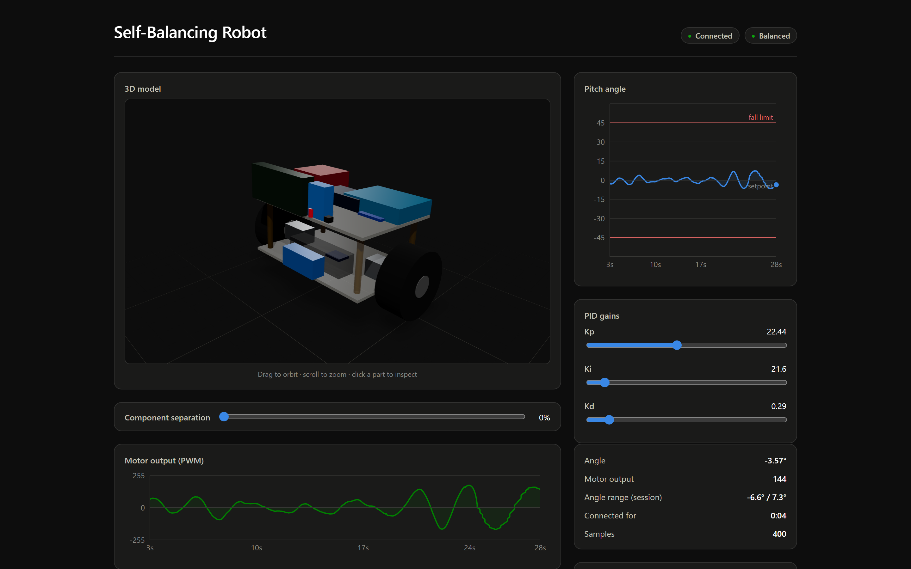

## What's in this repo

| Path | What it is |
|---|---|
| [`firmware/`](firmware/) | ESP32 firmware (PlatformIO): IMU sensor fusion, PID balance loop, WebSocket telemetry client |
| [`docs/screenshots/`](docs/screenshots/) | Screenshots of the dashboard, 3D/2D model, and RL training (see below) |

`firmware/README.md` has full setup/wiring/protocol detail for the piece
that's here.

## How the full project fits together

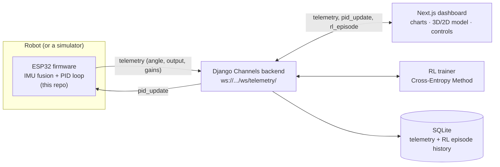

Every participant — the robot, the dashboard, and the RL trainer — is just a
WebSocket client on the same `/ws/telemetry/` endpoint, all sending and
receiving the same three message types (`telemetry`, `pid_update`,
`rl_episode`). That's *why* the RL trainer can propose new gains: it sends
`pid_update` exactly the way the dashboard's sliders do, so it can never
bypass the firmware's own fall-angle safety cutoff — it's not a separate,
riskier control path, just another client turning the same knob. This repo
is the `ESP32 firmware` box above; the rest is documented here in screenshots
only.

## Screenshots

### Live telemetry & control

The hero row: the 3D model and the live angle chart, visible together (no
navigating between pages to see both). PID gains are draggable sliders that
apply live over the WebSocket.

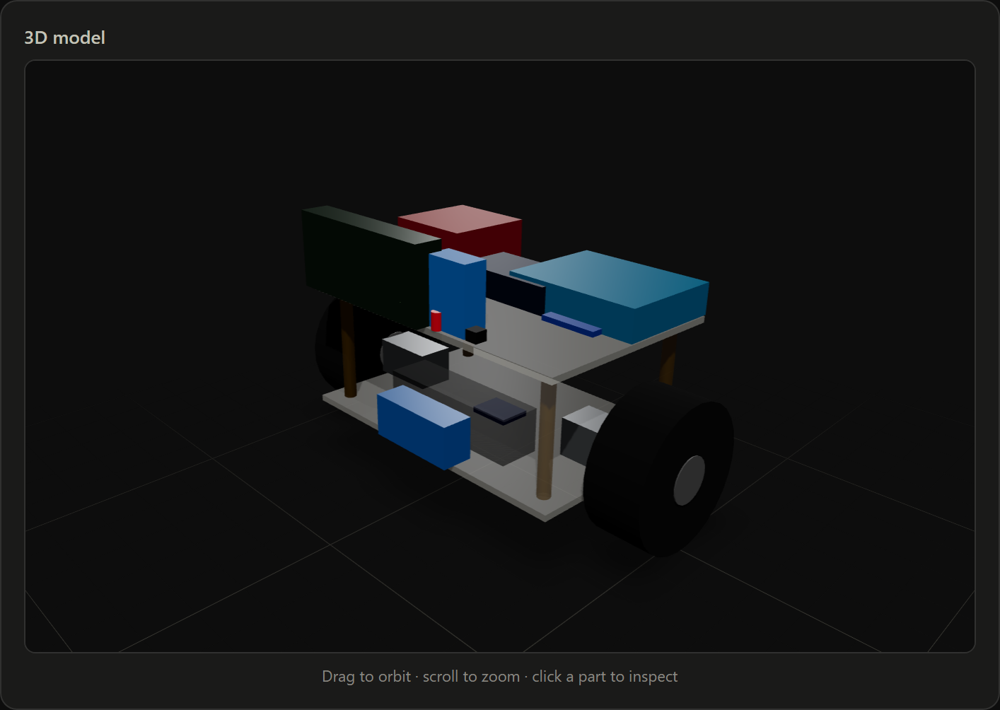
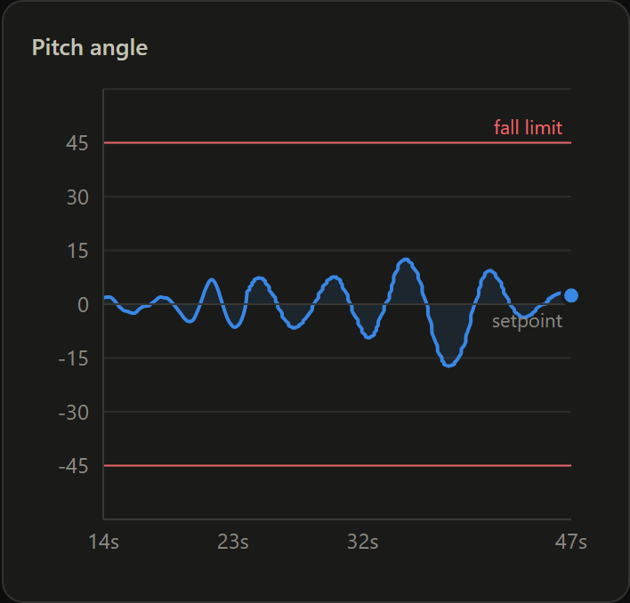
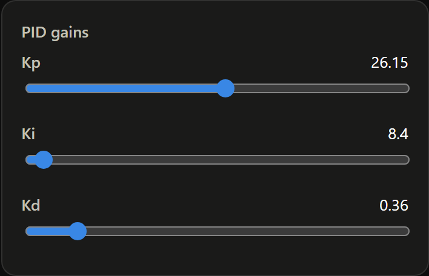
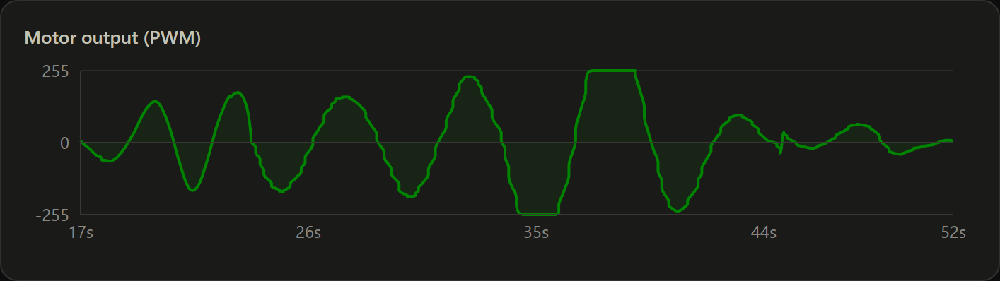
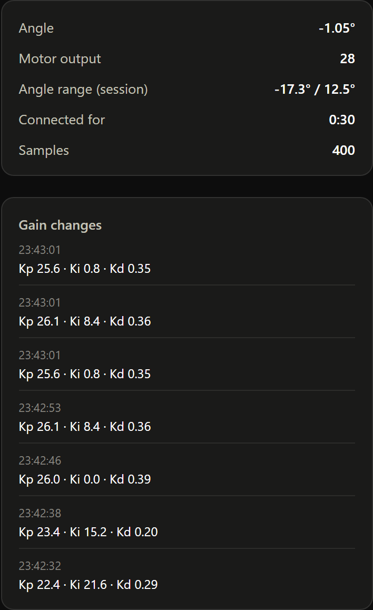

### RL training

An episodic auto-tuner (Cross-Entropy Method) that searches for better
Kp/Ki/Kd by trying a candidate gain-set for a few seconds at a time and
scoring how stable the robot stayed. This chart is from an actual training
run against a simulated plant — reward climbing (and variance shrinking) as
the search converges, red dots marking any episode where it fell:

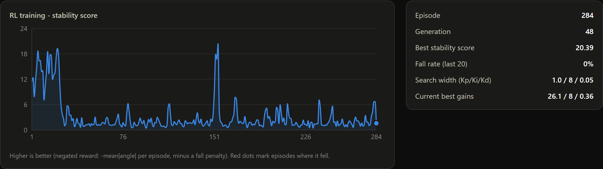

### 3D model

Real-world-scale primitives sized from each component's actual bounding box,
colored by what the hardware actually looks like rather than by category —
black rubber tires with a separate hub, green PCB tones, brass standoffs.
The model's tilt is driven by live telemetry, and the wheels spin at a rate
driven by live motor output. A "component separation" control explodes the
whole assembly apart for a clearer look at what's stacked where:

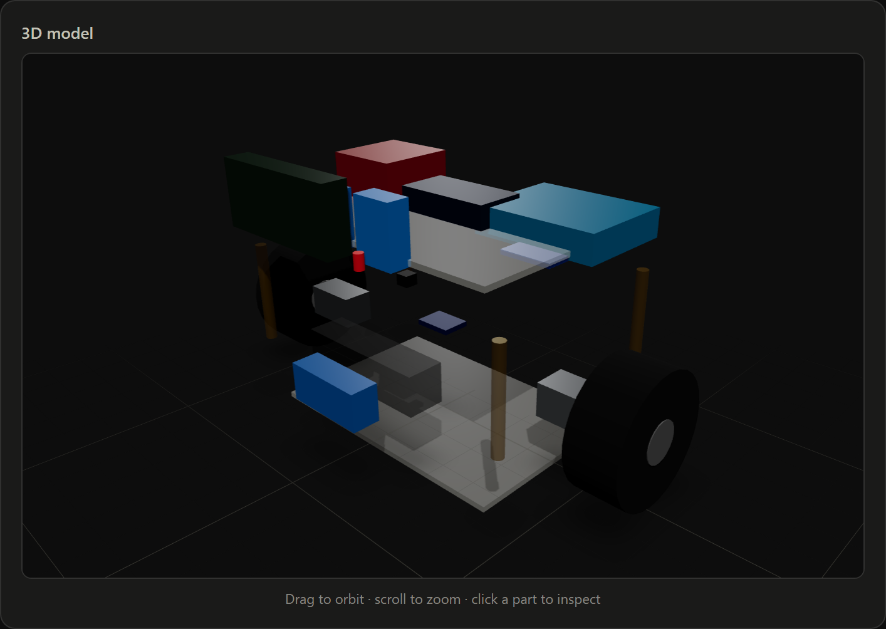

### 2D schematic

Four orthographic views (Top / Front / Left / Right), generated from the
same part data as the 3D model so the two can never drift out of sync.
Projection is geometrically real, not just a flat icon swap — a wheel
renders as a rectangle from the top or front (you're looking at its edge)
and only as a circle from the left/right (you're looking straight down its
axle), exactly like the real part would:

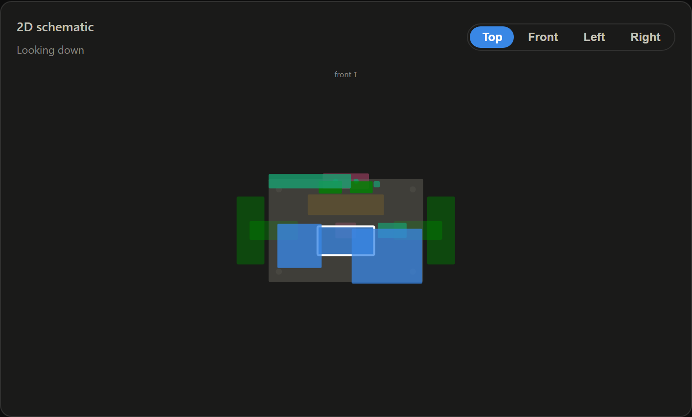
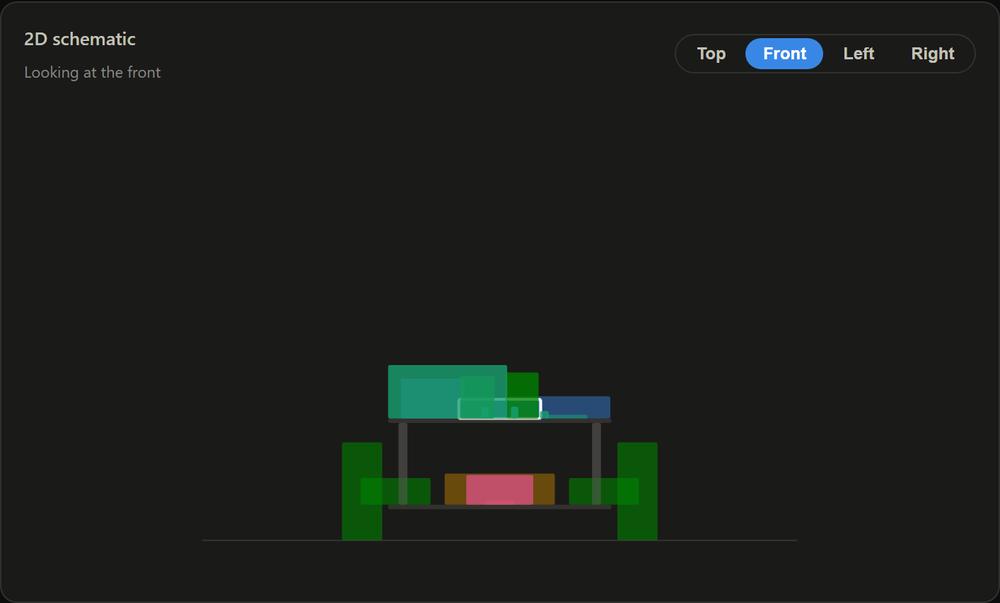
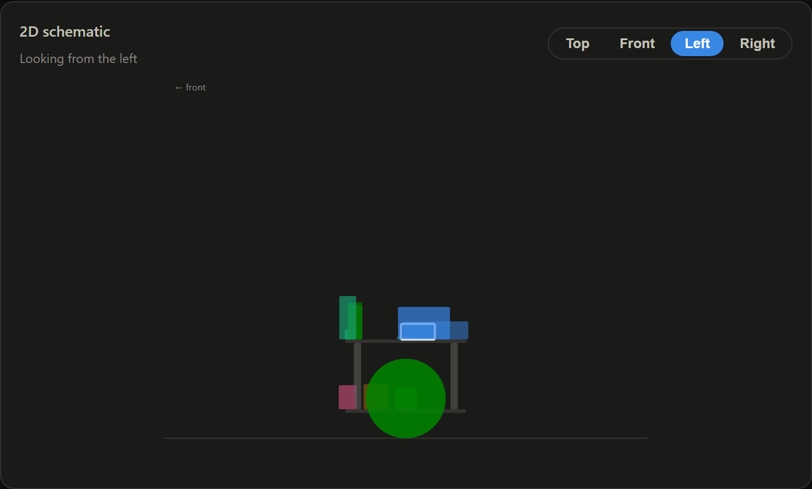

### Component reference & pin wiring

Clicking any component — in the 3D model, the 2D schematic, or the table —
shows its real spec and, for anything actually wired into the firmware
(source in this repo — see [`firmware/include/Config.h`](firmware/include/Config.h)),
its exact pin-to-pin connections. Reserved components (servos, Bluetooth,
the Arduino UNO) honestly show "not connected" rather than invented wiring:

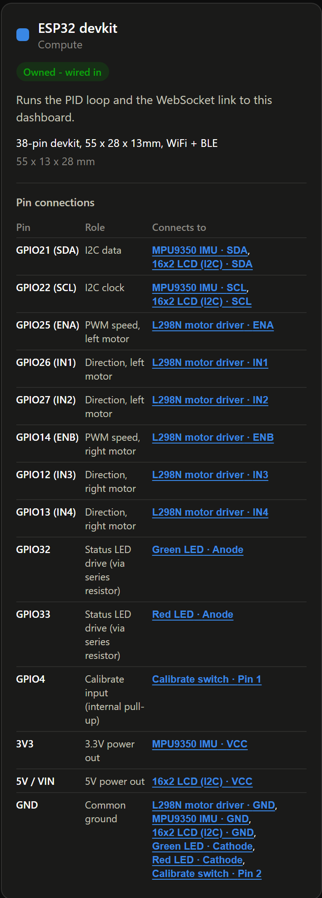
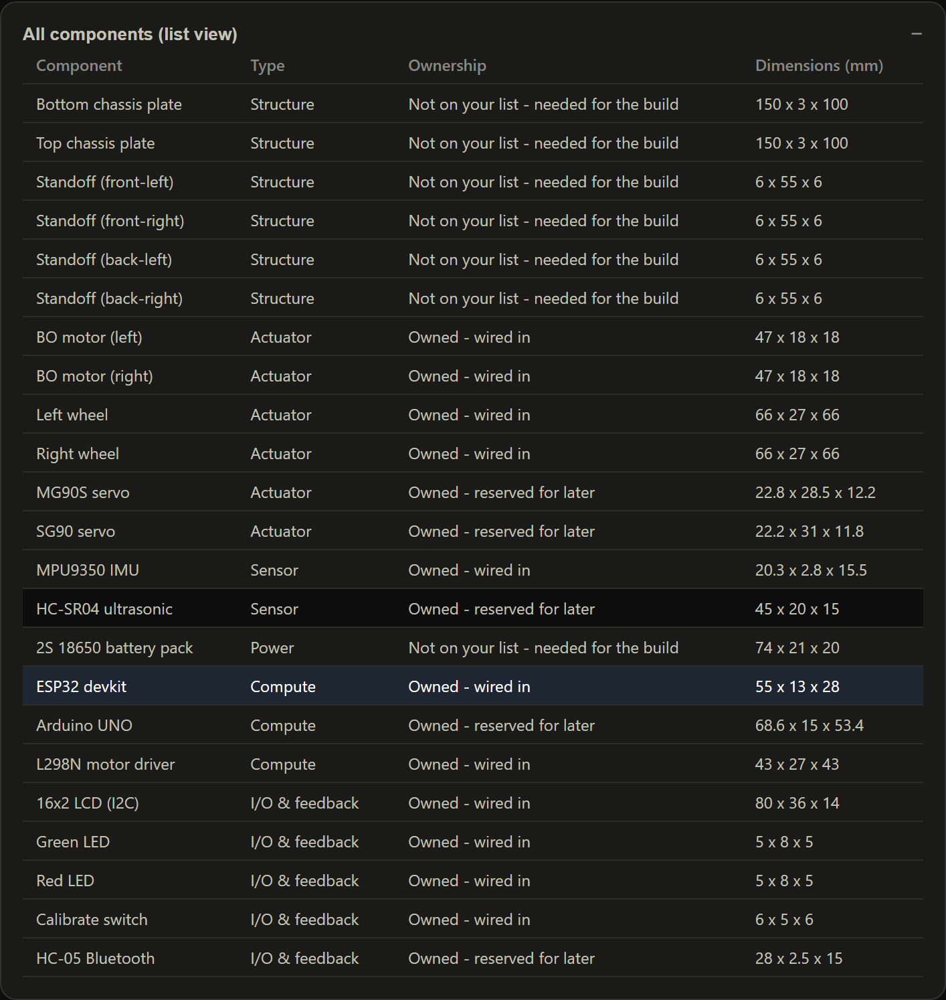

## Hardware

Everything on the original component list, plus a few chassis/power items
the build needs but weren't on that list (clearly marked as such in the
dashboard, not silently presented as owned):

| Component | Role | Status |
|---|---|---|
| ESP32 devkit | Runs the PID loop + WebSocket link | Wired in |
| MPU9350 IMU | Pitch angle (accel + gyro fusion) | Wired in |
| L298N motor driver | Drives both BO motors | Wired in |
| 2x BO motor + wheel | Drive/balance | Wired in |
| 16x2 LCD (I2C) | Onboard status display | Wired in |
| Green / red LED | Balanced / fallen indicator | Wired in |
| Calibrate switch | Re-zero IMU + reset PID integral | Wired in |
| MG90S / SG90 servo | Reserved for a future pan-tilt mount | Owned, not wired |
| HC-05 Bluetooth | Reserved for a manual-control fallback | Owned, not wired |
| HC-SR04 ultrasonic | Reserved for future obstacle detection | Owned, not wired |
| Arduino UNO | Reserved as an optional watchdog MCU | Owned, not wired |
| Chassis plates, standoffs, battery pack | Structural/power — needed to build this | Not on the original list |

Full pin-level wiring for every "wired in" part is in `firmware/README.md`
and visible in the pin-connections screenshot above.

## Running the firmware

```
cd firmware
cp include/Secrets.h.example include/Secrets.h   # fill in WiFi + backend host
pio run -t upload
pio device monitor
```

It'll connect to WiFi and try to reach a backend over WebSocket at the host/
port in `Secrets.h` — see `firmware/README.md` for the wiring table, first-run
calibration, and the telemetry protocol. Without a backend to talk to, it'll
still balance locally (the WebSocket send just becomes a no-op); the backend,
dashboard, and RL trainer that give it a live UI aren't included in this repo.

## Design notes worth knowing

- **The dashboard's 2D/3D model is a schematic-scale reference, not
  fabrication-ready CAD.** Dimensions are typical/approximate figures for
  these common hobby parts, and each part is one primitive sized to its real
  bounding box, not a detailed mesh.
- **Wheel spin in the 3D view is illustrative.** There's no wheel encoder on
  this build, so the spin rate is derived from motor PWM, not a measured
  wheel speed.
- **The RL trainer never bypasses the firmware's safety cutoff.** It only
  ever proposes `(Kp, Ki, Kd)` over the same `pid_update` path the dashboard
  sliders use — see the architecture section above.
