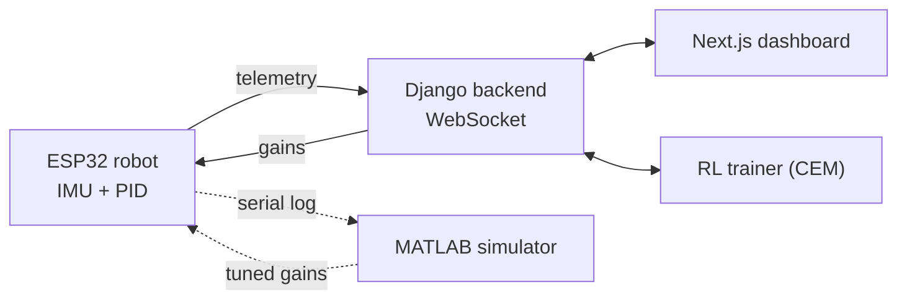
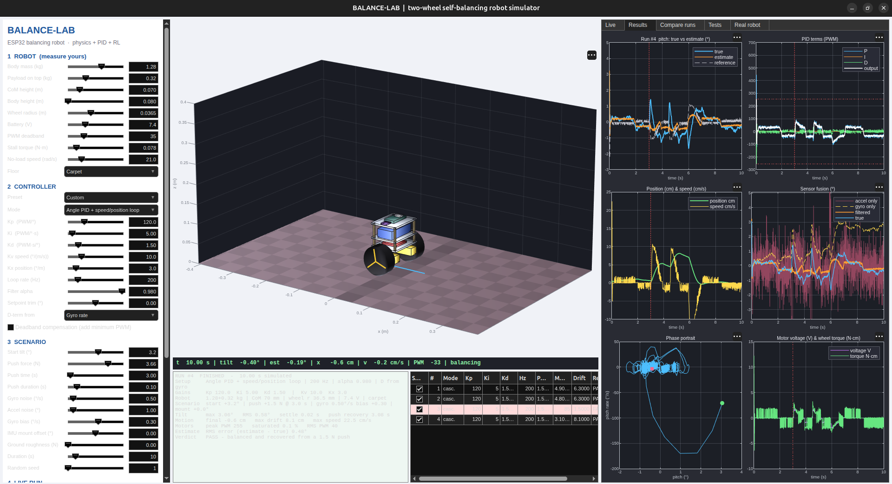
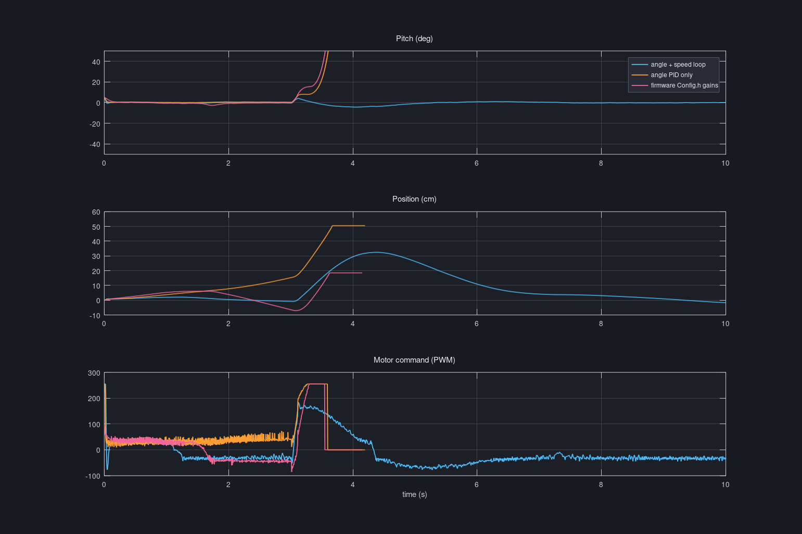
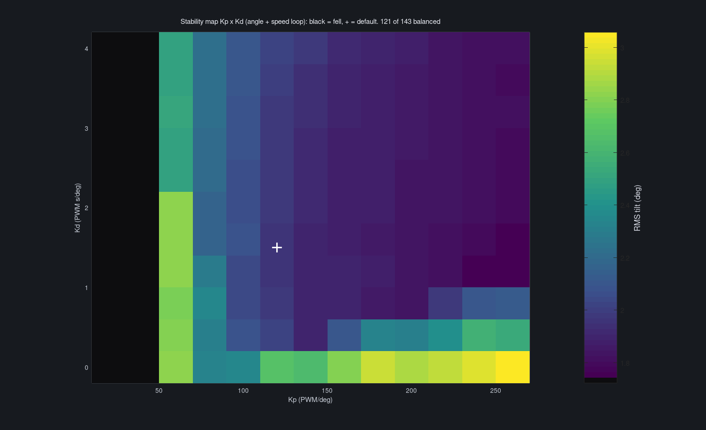
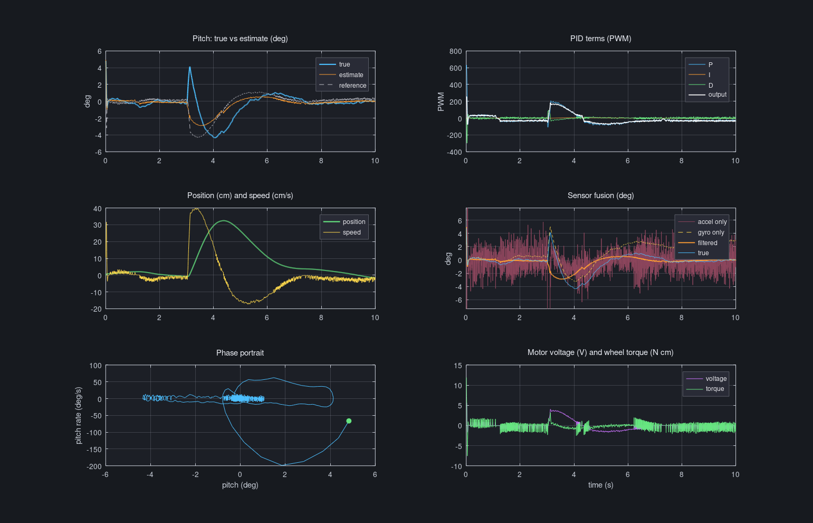
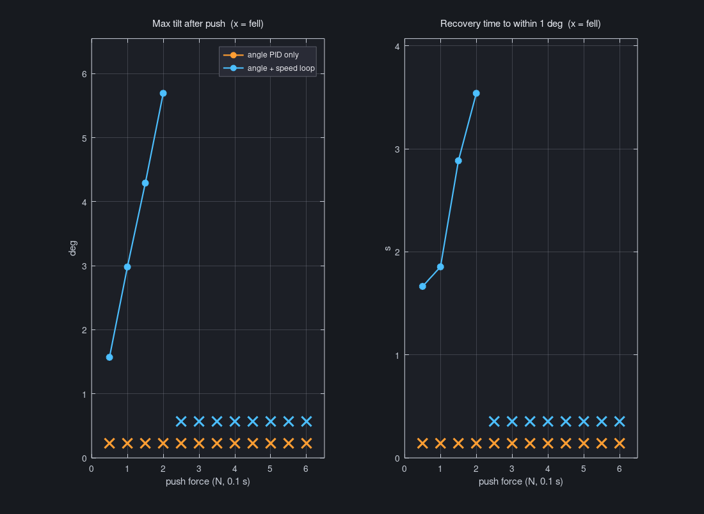
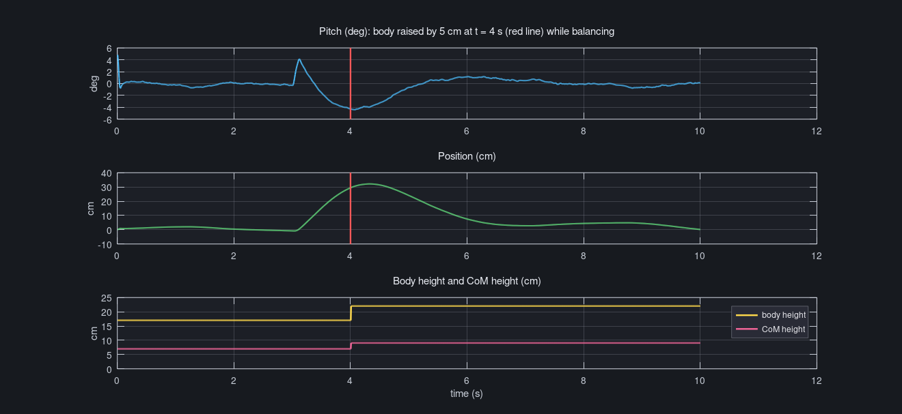

<h1 align="center">Self-Balancing Robot · ESP32</h1>

<p align="center">
  A two-wheel balancing robot with a live web dashboard, an RL gain auto-tuner and a MATLAB physics simulator.
</p>

<p align="center">
  
  
  
</p>

<p align="center">
  
</p>

> This repo holds the **ESP32 firmware**, the **MATLAB simulator** and screenshots of the full project.
> The Django backend and Next.js dashboard live in a private repo.

## Overview

- **Balances** with an MPU9350 IMU (complementary filter) and a 200 Hz PID loop on the ESP32.
- **Tunes live** — PID gains are sliders on the web dashboard, sent over WebSocket, no reflashing.
- **Learns** — a Cross-Entropy-Method RL trainer proposes better gains through the same safe channel.
- **Simulates** — a MATLAB lab models the exact robot so controller changes are tested before hardware.

## How it fits together



Every client uses the same `/ws/telemetry/` endpoint, so the RL trainer changes gains exactly like a
dashboard slider and can never bypass the firmware's 45° fall cut-off.
[How the PID works →](docs/PID_CONTROL.md)

## Dashboard

<table>
  <tr>
    <td width="50%"><br><sub><b>3D model</b> — tilt and wheel spin follow live telemetry</sub></td>
    <td width="50%"><br><sub><b>Exploded view</b> — what's stacked where</sub></td>
  </tr>
  <tr>
    <td><br><sub><b>RL training</b> — reward rises as the gain search converges</sub></td>
    <td><br><sub><b>2D schematic</b> — four orthographic views from the same part data</sub></td>
  </tr>
</table>

<details>
<summary><b>More screenshots</b> — charts, PID sliders, wiring, parts</summary>
<br>
<table>
  <tr>
    <td width="33%"><br><sub>Pitch angle</sub></td>
    <td width="33%"><br><sub>Live PID sliders</sub></td>
    <td width="33%"><br><sub>Session stats and gain log</sub></td>
  </tr>
  <tr>
    <td colspan="2"><br><sub>Motor output</sub></td>
    <td><br><sub>Pin-level wiring</sub></td>
  </tr>
  <tr>
    <td><br><sub>Top view</sub></td>
    <td><br><sub>Side view</sub></td>
    <td><br><sub>Component table</sub></td>
  </tr>
</table>
</details>

## Hardware

| Part | Role |
|---|---|
| ESP32 DevKit | PID loop, Wi-Fi / WebSocket |
| MPU9350 IMU | Pitch angle (accel + gyro) |
| L298N + 2× BO motors | Drive and balance |
| 16×2 I2C LCD, green/red LEDs | Status: balanced / fallen |
| Push switch | Re-zero IMU, reset PID |

Owned but not wired yet: HC-SR04, HC-05, MG90S/SG90 servos, Arduino UNO.
Pin-level wiring is in [`firmware/README.md`](firmware/README.md).

## MATLAB simulator

[`matlab/balance_lab.m`](matlab/balance_lab.m) — one file, MATLAB R2021a+, no toolboxes. It simulates
this robot (inverted-pendulum physics, motors, IMU noise, PID) in a live 3D dashboard, where every
parameter can be changed mid-run. It also includes tests, an RL auto-tune and sim-vs-real comparison
from a serial log.

<p align="center">
  
</p>

<table>
  <tr>
    <td width="50%"><br><sub><b>Why encoders matter</b> — same robot and push: only the speed-loop controller stays up</sub></td>
    <td width="50%"><br><sub><b>Kp × Kd map</b> — 121 of 143 gain pairs balance; black = fell</sub></td>
  </tr>
</table>

| Key finding (simulation, estimated parameters) | |
|---|---|
| Angle-only PID (current firmware) | falls after a 0.5–1.5 N push: it can't tell it's rolling away |
| Adding a speed/position loop (needs encoders) | recovers from pushes up to 2 N |
| IMU mounted 2° off level | stays up but drifts ~65 cm |

<details>
<summary><b>More results</b> — full run, push sweep, live height change</summary>
<br>
<br>
<br>
<br>
Raw data: <a href="matlab/results/"><code>matlab/results/</code></a>
</details>

## Quick start

```bash
# Firmware
cd firmware
cp include/Secrets.h.example include/Secrets.h   # WiFi + backend host
pio run -t upload && pio device monitor
```

```matlab
% Simulator
cd matlab
balance_lab                % dashboard
balance_lab('showcase')    % regenerate result graphs
```

The robot still balances without a backend; telemetry sending just becomes a no-op.

<details>
<summary><b>Project story</b> — motivation, challenges, lessons</summary>

**Why:** it was inspired by an ESP32 + Django "Smart Parking" project. The idea was to make hobby
hardware feel like a real product, using a control problem harder than a threshold check.

**Hardware first, simulation second.** The firmware and dashboard were built around the real robot.
Simulators came later because RL training needs hours of runtime that a battery-powered robot can't
give.

**Challenges worth noting**
- A WebSocket echo bug made the robot read its own telemetry as new gains. It was fixed with typed
  messages and found by a round-trip test.
- The first simulator was a random walk on which Ki and Kd did nothing. It was rebuilt as a real
  closed-loop pendulum before any RL training.
- The accelerometer is fooled by the robot's own acceleration. Modelling this changed which gains
  work.
- The RL reward was checked by hand (zero gains fail, defaults pass) before trusting its curves.
</details>

## Roadmap

- [ ] Wheel encoders + speed loop (the clearest win in simulation)
- [ ] Save tuned gains across reboots
- [ ] Wire HC-SR04 (obstacles), HC-05 (manual control), servos (pan-tilt), UNO (watchdog)
- [ ] Calibrate the simulator against a logged real run
- [ ] Run the RL tuner on the real robot under supervision
