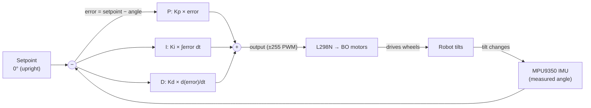
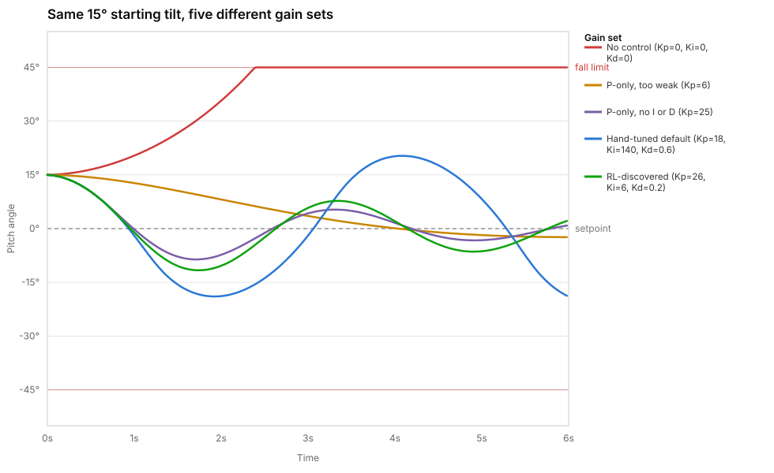

# PID Control, Explained

How this robot actually stays upright, in plain language, with the exact
formula the firmware runs and a chart generated from this project's own
simulated plant — not a generic textbook example.

## The problem: an inverted pendulum

A two-wheel robot balancing on its axle is an *inverted pendulum*: the
moment it tips even slightly off vertical, gravity pulls it further off
vertical, faster, with no natural restoring force. Left alone it falls in
well under a second. The only way to stay up is to continuously measure how
far off vertical you are and drive the wheels to correct it — many times a
second, forever. That correction is what a PID controller computes.

## The control loop

This runs at 200Hz in [`firmware/src/PIDController.cpp`](../firmware/src/PIDController.cpp)
(see also [`IMU.cpp`](../firmware/src/IMU.cpp) for how "measured angle" is
derived from the raw accelerometer/gyro via a complementary filter). Every
5ms: read the angle, compute the three terms below, sum them into a motor
command, apply it, repeat.

## The three terms

**Proportional (P)** — `Kp * error`. The immediate reaction: the further
off vertical, the harder it drives the wheels back. Too low and the robot
falls before it can correct; too high and it overcorrects, overshoots
vertical, and starts oscillating.

**Integral (I)** — `Ki * (running sum of error over time)`. Fixes
*persistent* lean that P alone can't — e.g. the center of mass isn't
perfectly centered over the axle, or the IMU has a small calibration
offset, so a P-only controller settles into a slight permanent tilt instead
of true zero. I keeps pushing while that bias persists. The failure mode is
"integral windup": too much I, or too much time spent away from setpoint
while it's building up, and the accumulated correction overshoots hard once
the error finally crosses zero — see the comparison chart below, where this
is exactly what happens.

**Derivative (D)** — `Kd * (rate of change of error)`. Damping: it reacts
to *how fast* the angle is changing, not just how far off it is, which
resists sudden swings and settles oscillation that P+I alone would leave
ringing. Too much D and it starts reacting to sensor noise instead of real
motion, making the motors twitchy.

The firmware's actual implementation
([`PIDController::compute`](../firmware/src/PIDController.cpp)) clamps the
integral term to `±(outputLimit / Ki)` — a direct anti-windup guard, capping
how far the accumulated error can push the output regardless of how long
the robot spends away from setpoint.

## Tuning it: two ways

**Manually**, live, from the dashboard's sliders — drag `Kp`/`Ki`/`Kd` and
the new gains apply immediately over WebSocket, no reflashing. Good for
getting a feel for each term's effect in real time.

**Automatically**, via the RL auto-tuner in `backend/rl/` — an episodic
Cross-Entropy Method search that tries a candidate `(Kp, Ki, Kd)` for a few
seconds, scores how stable the robot stayed, and refits its search toward
whatever scores best. It's not guessing blind: it's proposing gains over
the *exact same* `pid_update` message the dashboard sliders use, so it's
bound by the same PID formula and the same safety cutoff above — see the
root README's architecture section.

### What the RL trainer actually found

This chart is generated directly from this project's simulated plant model
(same PID formula, same physics constants as `backend/simulate_robot.py`,
random disturbances turned off for a clean comparison) — five gain sets,
same 15° starting tilt, six seconds each:

- **No control** diverges straight into the fall-limit and stays there —
  the inverted-pendulum problem, unmanaged.
- **P-only, too weak** (`Kp=6`) drifts back toward vertical but far too
  slowly to be usable.
- **P-only, no I or D** (`Kp=25`) overshoots and oscillates — no damping
  term to kill the swing.
- **The hand-tuned starting default** (`Kp=18, Ki=140, Kd=0.6`) — picked
  before any real tuning — swings *harder* than the P-only case: `Ki=140`
  is aggressive enough that integral windup makes it worse, not better.
- **What the RL trainer actually converged on** (`Kp=26, Ki=6, Kd=0.2`, from
  a real ~300-episode run against the simulator) settles fastest and
  tightest of the five. It found, correctly, that this plant wants *far*
  less integral action than the hand-picked starting point had — a real,
  literature-consistent result (excessive Ki plus frequent disturbances is
  a classic windup/oscillation combination), discovered empirically rather
  than assumed.

That gap between the naive default and what the search actually found is
the entire reason the RL auto-tuner exists in this project, not just a
demo feature.

## Further reading

Classic manual PID tuning methods (Ziegler–Nichols, Cohen–Coon, and
similar) tune from a step-response or ultimate-gain measurement taken once,
by hand. The Cross-Entropy Method here does something closer in spirit but
automated and iterative: it's still a search over the same three numbers,
just scored from real telemetry over repeated trials instead of a single
manual measurement. The RL trainer's own docs live alongside the backend
and dashboard source in a private repo (see the note at the top of the root
[`README.md`](../README.md)) — this page and the root README's architecture
section are the public-facing summary of how it works.
